# asierbayon.com

My personal site, built as a macOS-style desktop that turns into an iPhone home screen on mobile.

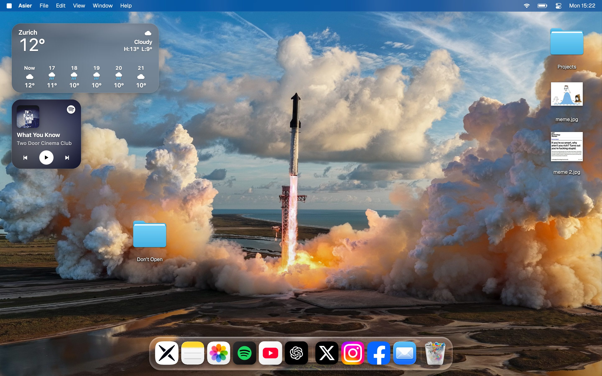

<p>
  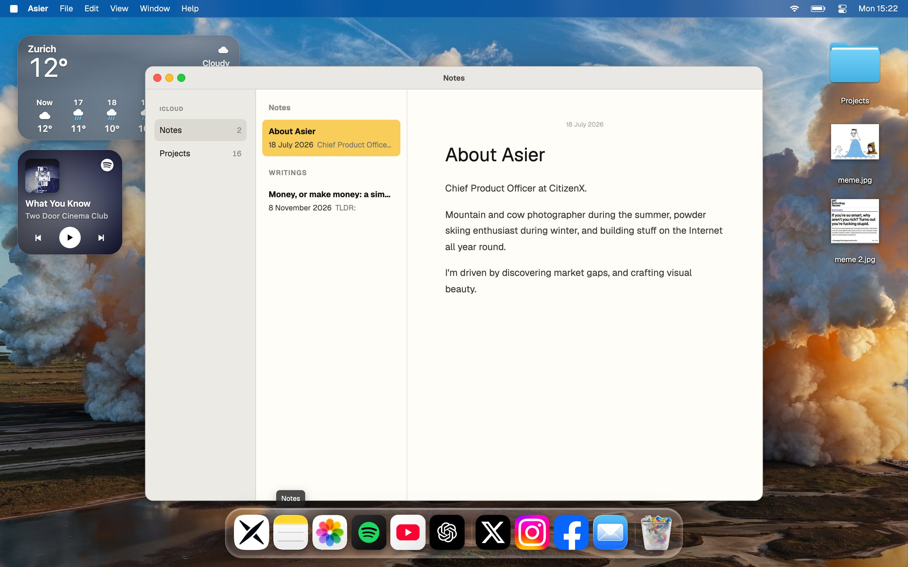
  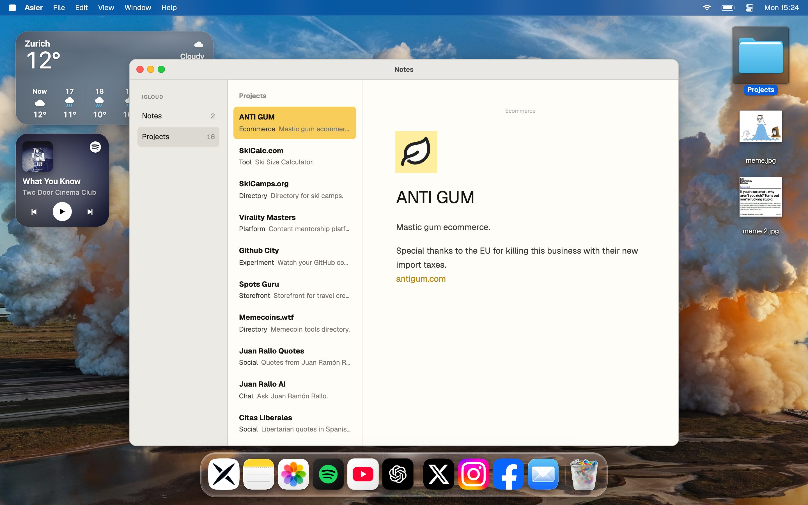
  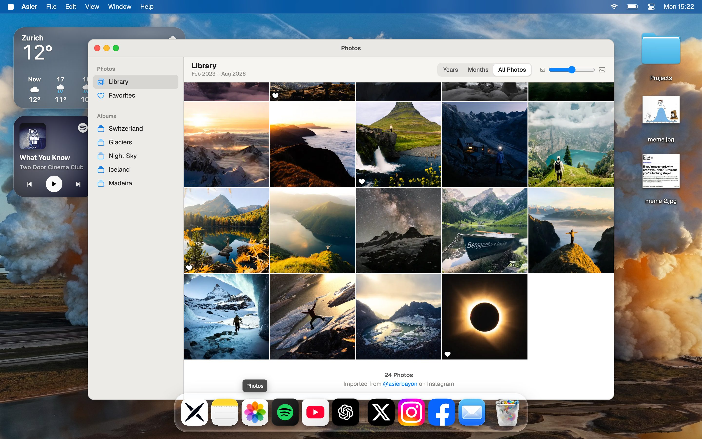
  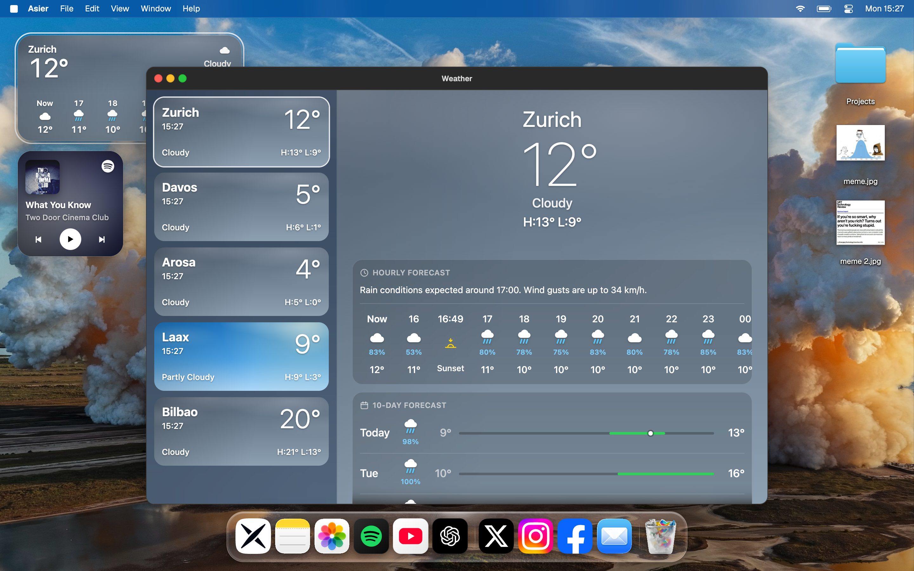
  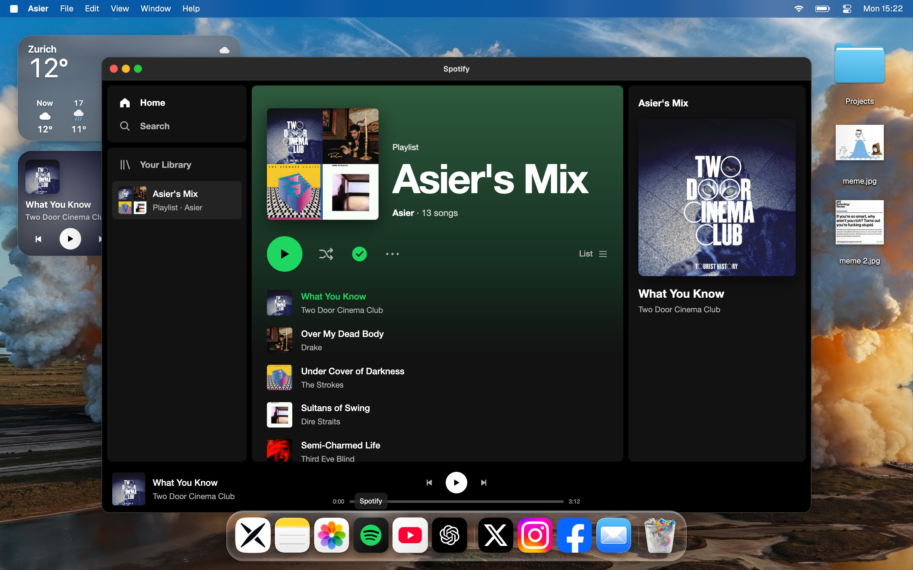
  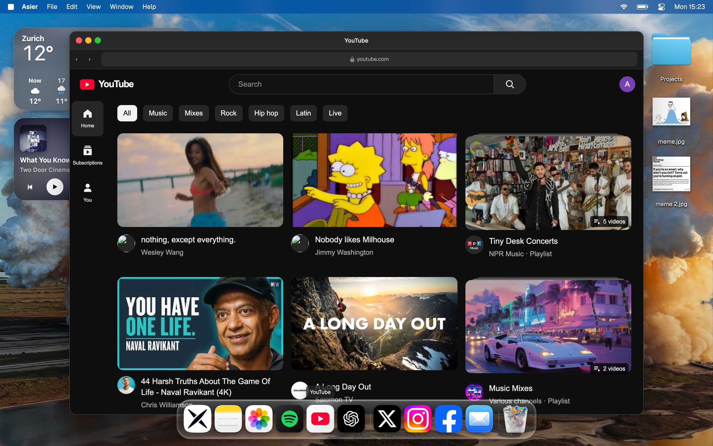
  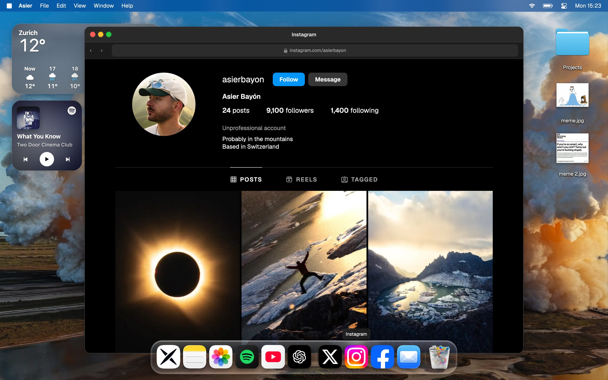
  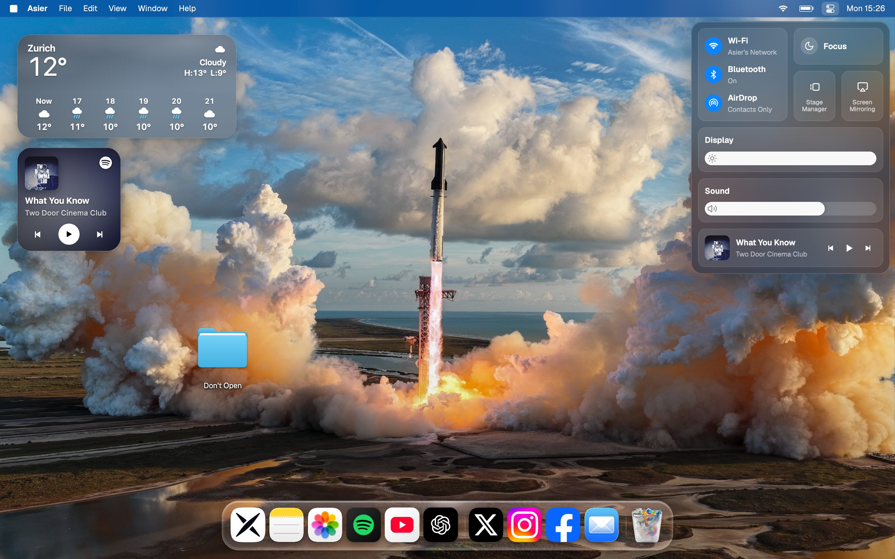
</p>

<p>
  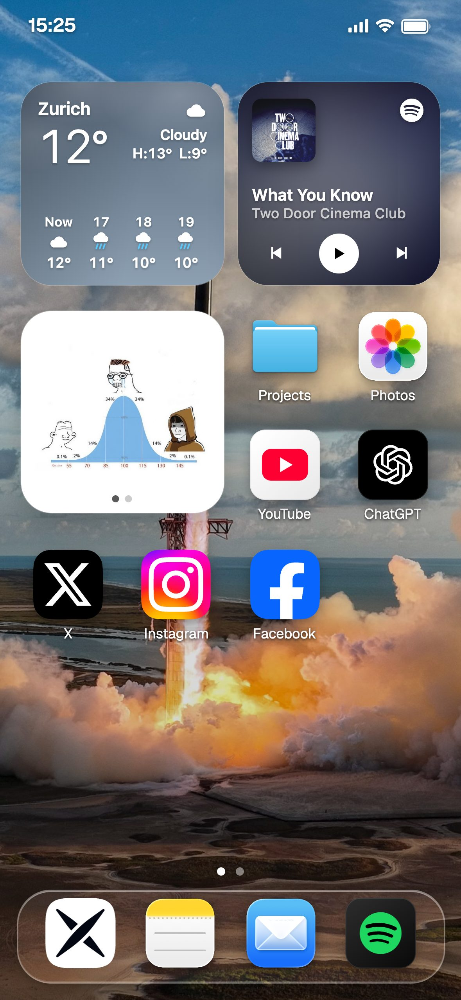
  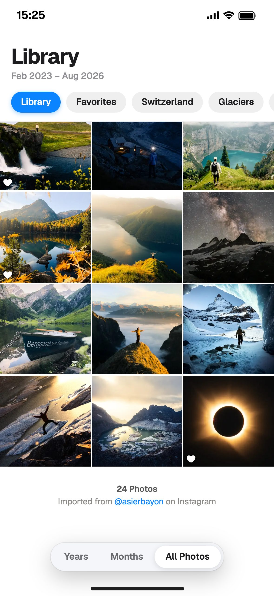
</p>

## Development

Requires Node.js `>=22.13.0`.

```bash
npm install
npm run dev
```
